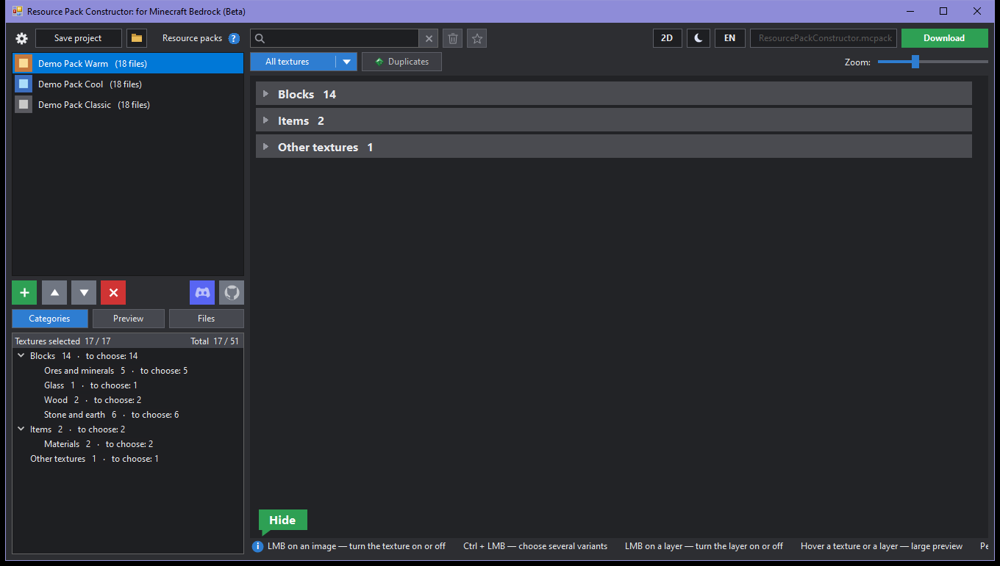

# BRPC — Bedrock Resource Pack Constructor

A Windows program for browsing Minecraft Bedrock resource packs side by side and merging them into one `.mcpack`.

Программа для Windows: показывает пакеты текстур Minecraft Bedrock рядом и собирает из них один `.mcpack`. [Описание на русском](#по-русски) ниже.

## Features

- Load packs from folders, `.mcpack`, `.zip` and `.mcaddon`; drag to reorder — the top pack has priority.
- Textures are sorted into types and categories; every texture shows the variants from all loaded packs, click to choose one or switch it off.
- Smart merge instead of plain overwrite: `terrain_texture.json`, `item_texture.json`, `blocks.json`, flipbooks, UI files, entities, geometry and `.lang` files are combined by content.
- PBR layers (reflections, emission, relief): pick each layer from any pack, texture sets are rebuilt to stay valid.
- Subpack (variant) selection per pack.
- 3D preview of mob textures on the game's own models (needs Minecraft for Windows installed), rotate with the right mouse button.
- Search by file name or by the in-game object name.
- Built-in pixel editor for quick fixes, a file browser with a text/JSON editor.
- Favourites: save any texture inside the program and reuse it in later builds.
- Projects (`.brpc`) remember packs, order and every choice.
- Light and dark theme, English and Russian interface.

## Download and run

Take `BRPC.exe` from the [Releases](../../releases) page and run it. Nothing to install: it needs only .NET Framework 4.x, which is part of Windows 10 and 11.

## Build from source

The whole program is one file, `BRPC.cs`, and compiles with the C# compiler that ships with Windows — no Visual Studio or SDK required.

1. Download or clone this repository.
2. Double-click `build.bat`.
3. `BRPC.exe` appears next to it.

Because of that compiler the code stays within C# 5.

## Using built packs

A built pack is made of other people's work. It is for your own game only. Publish or share it only with the permission of the original authors — they are listed in the `credits` folder inside the pack and in its `manifest.json`.

## Where it keeps its data

- Settings and favourites: `%APPDATA%\BedrockPackStudio`
- Unpacked archives (removed on exit): `%TEMP%\BedrockPackStudio`

The program never changes the packs you load, except when you edit a file in it yourself.

## Support the project

Feedback and bug reports are welcome in [Issues](../../issues).

BRPC is free. If you like it, you can support the developer: the buttons are in the bottom-right corner of the texture area while it is empty. Their links are set in the `Support` class at the top of `BRPC.cs`.

## License

[MIT](LICENSE).

Not an official Minecraft product. Not approved by or associated with Mojang or Microsoft.

---

## По-русски

**BRPC** показывает загруженные пакеты текстур рядом, даёт выбрать для каждой текстуры вариант из любого пакета и собирает результат в один `.mcpack`.

- Пакеты загружаются из папок, `.mcpack`, `.zip` и `.mcaddon`; порядок меняется перетаскиванием, верхний важнее.
- Текстуры разложены по типам и категориям; щелчок выбирает вариант или выключает текстуру.
- Файлы JSON и `.lang` объединяются по содержимому, а не затирают друг друга.
- Слои PBR (отражения, свечение, рельеф) выбираются по отдельности из любого пакета.
- 3D-вид текстур мобов на моделях из установленной игры, поиск по названию объекта в игре.
- Встроенный редактор текстур, просмотр и правка файлов пакета.
- Избранное, проекты `.brpc`, светлая и тёмная тема, русский и английский язык.

**Запуск:** скачайте `BRPC.exe` со страницы [Releases](../../releases). Устанавливать ничего не нужно.

**Использование собранных пакетов:** собранный пакет состоит из чужих работ и предназначен только для вашей игры. Выкладывать или передавать его можно только с разрешения авторов исходных пакетов — они перечислены в папке `credits` внутри пакета и в его `manifest.json`.

**Сборка из исходного кода:** дважды щёлкните `build.bat` — он соберёт `BRPC.exe` компилятором, который уже есть в Windows.

Это не официальный продукт Minecraft; программа не связана с Mojang и Microsoft.
